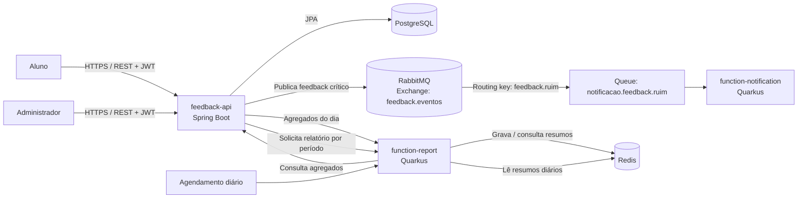

# Courses Feedback

Aplicação de feedback acadêmico desenvolvida como projeto de pós-graduação, utilizando uma arquitetura distribuída composta por uma API principal e duas aplicações serverless (functions) independentes.

O sistema permite que alunos matriculados em cursos registrem avaliações. Feedbacks com notas baixas geram eventos assíncronos consumidos pela function de notificação. Os dados também são consolidados diariamente para que a function de relatórios possa gerar indicadores por período com o auxílio do Redis.

## Sumário

- [Visão geral da arquitetura](#visão-geral-da-arquitetura)
- [Módulos da aplicação](#módulos-da-aplicação)
- [Fluxos de comunicação](#fluxos-de-comunicação)
- [Tecnologias utilizadas](#tecnologias-utilizadas)
- [Banco de dados e armazenamento](#banco-de-dados-e-armazenamento)
- [Segurança](#segurança)
- [Infraestrutura Docker Compose](#infraestrutura-docker-compose)
- [Configuração do ambiente](#configuração-do-ambiente)
- [Execução da aplicação](#execução-da-aplicação)
- [Verificação dos serviços](#verificação-dos-serviços)
- [Encerramento e persistência dos dados](#encerramento-e-persistência-dos-dados)
- [Testes manuais](#testes-manuais)
- [Considerações para implantação em cloud](#considerações-para-implantação-em-cloud)

## Visão geral da arquitetura

A solução é organizada em três módulos independentes:

- **feedback-api:** aplicação principal, responsável pelas funcionalidades de negócio, autenticação, autorização, persistência dos dados e integração com os serviços auxiliares.
- **function-notification:** function responsável por consumir eventos de feedbacks críticos publicados no RabbitMQ.
- **function-report:** function responsável por consolidar os indicadores diários, armazená-los no Redis e gerar relatórios por período.

A API é o ponto de entrada do fluxo de negócio. As functions não substituem a API: elas executam responsabilidades específicas, mantendo o processamento assíncrono de notificações separado da consulta e consolidação de relatórios.



O diagrama representa as responsabilidades e integrações da solução. Na execução local, os serviços são conectados pela rede Docker `courses-feedback-network`.

## Módulos da aplicação

### `feedback-api`

Aplicação principal desenvolvida com Spring Boot. É responsável por:

- autenticar usuários e validar os tokens JWT;
- controlar o acesso às funcionalidades conforme o perfil do usuário;
- administrar usuários, cursos e matrículas;
- receber e persistir feedbacks enviados pelos alunos;
- publicar eventos no RabbitMQ quando um feedback é classificado como crítico;
- disponibilizar agregados diários para a function de relatórios;
- receber solicitações de relatórios dos administradores e encaminhá-las à `function-report`.

O servlet path da aplicação é `/api/v1`. Entre as operações centrais do fluxo estão:

| Operação | Endpoint | Responsabilidade |
|---|---|---|
| Registrar feedback | `POST /api/v1/feedbacks` | Recebe a avaliação do aluno autenticado. |
| Consultar relatório | `GET /api/v1/feedbacks/relatorios/inicio/{inicio}/fim/{fim}` | Solicita um relatório para o período informado, com acesso restrito a administradores. |
| Disponibilizar agregado diário | `GET /api/v1/internal/feedbacks/agregados-diarios/{data}` | Endpoint interno utilizado pela `function-report` na consolidação diária. |

Consulte [`feedback-api/README.md`](feedback-api/README.md) para detalhes dos endpoints, domínio, persistência e configuração da API.

### `function-notification`

Function desenvolvida com Quarkus que consome mensagens da fila `notificacao.feedback.ruim` no RabbitMQ.

Sua responsabilidade atual é receber o evento, desserializar o conteúdo, validar os dados relevantes e registrar as informações do feedback nos logs. A implementação atual não realiza, por si só, o envio de e-mail, SMS ou push notification para um serviço externo.

A function utiliza uma fila e um exchange previamente declarados pela aplicação principal. Sua configuração de consumo não declara novamente esses recursos.

Consulte [`function-notification/README.md`](function-notification/README.md) para detalhes do contrato da mensagem e do consumidor.

### `function-report`

Function desenvolvida com Quarkus. Suas principais responsabilidades são:

- executar a consolidação diária dos feedbacks;
- consultar na API os agregados de uma data;
- armazenar os resumos diários no Redis;
- consultar os resumos armazenados e montar relatórios para intervalos de datas;
- validar o período solicitado e sinalizar quando algum resumo diário necessário não estiver disponível.

O agendamento local utiliza o Quarkus Scheduler, configurado para consolidar o dia anterior à meia-noite e dez minutos, considerando o fuso `America/Sao_Paulo`. A geração do relatório utiliza os resumos previamente armazenados no Redis.

O endpoint de relatório da function é:

```http
GET /feedbacks/relatorio/inicio/{inicio}/fim/{fim}
```

A chamada é realizada pela `feedback-api`, que atua como ponto de entrada para os administradores. O endpoint da function é protegido por um token de serviço interno.

Consulte [`function-report/README.md`](function-report/README.md) para detalhes do agendamento, formato dos resumos, Redis e regras de geração do relatório.

## Fluxos de comunicação

### Cadastro de feedback e notificação assíncrona

1. O aluno autenticado envia um feedback para `POST /api/v1/feedbacks`, informando a matrícula, a descrição e a nota de 0 a 10.
2. A API identifica o usuário autenticado e verifica se ele possui o perfil permitido para registrar feedback.
3. A API consulta a matrícula e valida se ela pertence ao aluno autenticado.
4. O feedback é persistido no PostgreSQL.
5. Quando a nota caracteriza um feedback crítico (nota menor ou igual a 4), a API publica um evento no exchange `feedback.eventos`, utilizando a routing key `feedback.ruim`.
6. O RabbitMQ encaminha a mensagem para a fila durável `notificacao.feedback.ruim`.
7. A `function-notification` consome a mensagem, desserializa e valida o evento e registra os dados nos logs.

As demais avaliações são persistidas normalmente, mas não geram o evento de notificação crítica.

### Consolidação diária e geração de relatórios

1. O agendamento da `function-report` determina a data que será consolidada (o dia anterior, no fuso `America/Sao_Paulo`).
2. A function chama o endpoint interno da `feedback-api` para consultar os agregados daquele dia.
3. A API calcula e retorna os totais e a soma das notas, incluindo a distribuição por classificação.
4. A function grava o resumo no Redis, utilizando uma chave associada à data. Uma nova consolidação da mesma data sobrescreve o resumo anterior.
5. Quando um administrador solicita um relatório, a requisição chega à `feedback-api`.
6. A API valida a autorização e encaminha o período solicitado para a `function-report`.
7. A function consulta no Redis o resumo de cada dia do intervalo, valida a disponibilidade dos dados e calcula os indicadores consolidados.
8. A resposta retorna à API, que a disponibiliza ao administrador.

A classificação utilizada no negócio é: **RUIM** para notas de 0 a 4, **MEDIO** para notas de 5 a 7 e **BOM** para notas de 8 a 10. No relatório, esses grupos são apresentados como avaliações críticas, normais e boas, respectivamente.

## Tecnologias utilizadas

| Tecnologia | Utilização |
|---|---|
| Java 25 | Linguagem de desenvolvimento dos três módulos. |
| Spring Boot | Implementação da API principal. |
| Spring Security / JWT | Autenticação e autorização na API. |
| Spring Data JPA / Hibernate | Persistência e acesso ao PostgreSQL na API. |
| Flyway | Versionamento e execução das migrações do banco. |
| Spring AMQP | Publicação de eventos no RabbitMQ pela API. |
| Quarkus | Implementação das functions de notificação e relatório. |
| SmallRye Reactive Messaging | Consumo de mensagens RabbitMQ pela function de notificação. |
| Redis | Armazenamento dos resumos diários utilizados nos relatórios. |
| PostgreSQL 17 | Banco de dados relacional da aplicação. |
| RabbitMQ 4 Management | Mensageria assíncrona e interface de gerenciamento. |
| Docker / Docker Compose | Empacotamento e orquestração do ambiente local. |
| Insomnia | Execução dos testes manuais das APIs. |

## Banco de dados e armazenamento

### PostgreSQL

O PostgreSQL armazena os dados relacionais e transacionais da aplicação. As principais entidades persistidas são:

| Tabela | Responsabilidade |
|---|---|
| `usuario` | Armazena os dados dos usuários, incluindo informações de autenticação, perfil e situação da conta. |
| `curso` | Armazena os cursos e sua associação com o professor responsável. |
| `matricula` | Relaciona alunos e cursos, registrando a situação da matrícula. |
| `feedback` | Armazena a avaliação associada à matrícula, incluindo descrição, nota e data de criação. |

A aplicação utiliza Flyway para versionar o esquema e executar as migrações na inicialização. Consulte o módulo `feedback-api` para visualizar os scripts SQL e as restrições efetivamente aplicadas.

No Docker Compose, os dados do PostgreSQL ficam no volume nomeado `postgres_data`, montado em `/var/lib/postgresql/data`.

### Redis

O Redis armazena os resumos diários calculados pela `function-report`. A convenção de chave utilizada pela aplicação tem o prefixo:

```text
feedback:resumo:diario:
```

A data consolidada complementa esse prefixo. O Redis é iniciado com persistência AOF habilitada (`--appendonly yes`) e autenticação por senha. Os dados ficam no volume nomeado `redis_data`, montado em `/data`.

### RabbitMQ

O RabbitMQ transporta os eventos de feedbacks críticos. A topologia utilizada pela aplicação é:

| Recurso | Nome |
|---|---|
| Exchange | `feedback.eventos` |
| Tipo do exchange | `topic` |
| Queue | `notificacao.feedback.ruim` |
| Routing key | `feedback.ruim` |

A exchange e a fila são duráveis. A API declara a topologia durante sua inicialização; a function de notificação é configurada para consumir os recursos já existentes. Os dados persistidos pelo RabbitMQ ficam no volume `rabbitmq_data`, montado em `/var/lib/rabbitmq`.

## Segurança

### Autenticação e autorização de usuários

A `feedback-api` utiliza Spring Security com autenticação stateless baseada em JWT. As requisições protegidas devem apresentar um token válido.

Além de validar o token, a aplicação verifica a situação do usuário associado a ele. Usuários inexistentes, inativos ou excluídos não devem continuar acessando os recursos protegidos.

As operações de negócio aplicam regras de autorização conforme o perfil. Por exemplo, o cadastro de feedback é destinado a alunos e a consulta de relatórios é restrita a administradores. No cadastro, a API também verifica se a matrícula informada pertence ao aluno autenticado.

### Comunicação entre serviços

A comunicação entre a `feedback-api` e a `function-report` utiliza o cabeçalho:

```http
X-Internal-Service-Token: <token-configurado>
```

O mesmo segredo deve ser configurado nos dois serviços por meio de `INTERNAL_SERVICE_TOKEN`. A function valida o token nas rotas internas de relatório, e o cliente HTTP da API o envia nas chamadas à function.

Esse token é uma credencial de serviço e não substitui o JWT utilizado pelos usuários.

### Cuidados no ambiente local e em produção

- Não versionar o arquivo `.env` com credenciais reais.
- Utilizar segredos distintos e fortes nos ambientes de produção.
- Não publicar portas de banco de dados, Redis ou RabbitMQ diretamente na internet.
- Restringir o acesso à interface de gerenciamento do RabbitMQ.
- Revisar os endpoints de demonstração da `function-report` antes de uma implantação real. Eles existem para facilitar a demonstração acadêmica e não devem ser considerados endpoints públicos de produção.
- Configurar HTTPS/TLS, gestão de segredos, regras de rede e observabilidade adequadas no ambiente de cloud.

## Infraestrutura Docker Compose

O arquivo `docker-compose.yml` define seis serviços: três componentes de infraestrutura e os três módulos da aplicação.

### Serviços

| Serviço Compose | Container | Imagem / build | Porta publicada no host | Dependências declaradas |
|---|---|---|---|---|
| `postgres` | `courses-feedback-db` | `postgres:17` | `5432:5432` | — |
| `redis` | `courses-feedback-redis` | `redis:7-alpine` | `127.0.0.1:6379:6379` | — |
| `rabbitmq` | `rabbitmq` | `rabbitmq:4-management` | `5672:5672`, `15672:15672` | — |
| `feedback-api` | `courses-feedback-app` | `./feedback-api/Dockerfile` | `8080:8080` | PostgreSQL saudável e RabbitMQ saudável |
| `function-notification` | `courses-feedback-notification` | `./function-notification/Dockerfile` | Nenhuma | RabbitMQ saudável |
| `function-report` | `courses-feedback-report` | `./function-report/Dockerfile` | `8081:8081` | Redis saudável |

Todos os serviços participam da rede Docker `courses-feedback-network`. Dentro dessa rede, os serviços podem se comunicar usando os nomes dos serviços Compose e as portas internas dos respectivos containers. Por exemplo, a API acessa o PostgreSQL pelo host configurado em `DB_HOST`; a function de relatório acessa a API por `http://feedback-api:8080` e o Redis por `redis://redis:6379`.

### Portas disponíveis no host

| Porta | Serviço | Utilização |
|---|---|---|
| `5432` | PostgreSQL | Conexões locais ao banco. |
| `6379` | Redis | Conexões locais ao Redis; o bind está limitado a `127.0.0.1`. |
| `5672` | RabbitMQ | Protocolo AMQP. |
| `15672` | RabbitMQ Management | Interface web de administração do RabbitMQ. |
| `8080` | `feedback-api` | API principal. |
| `8081` | `function-report` | Endpoints da function de relatório, inclusive para testes locais. |

A `function-notification` não publica uma porta HTTP no host neste Compose: ela atua como consumidora de mensagens RabbitMQ.

### Healthchecks e ordem de inicialização

O Compose define healthchecks para:

- **PostgreSQL:** executa `pg_isready` com o usuário e banco configurados.
- **Redis:** executa `PING` autenticado e verifica a resposta `PONG`.
- **RabbitMQ:** executa `rabbitmq-diagnostics ping`.

A API aguarda PostgreSQL e RabbitMQ em estado saudável. A function de notificação aguarda RabbitMQ saudável. A function de relatório aguarda Redis saudável.

O Compose não declara healthchecks para `feedback-api` ou para as duas functions. Além disso, a `function-report` não possui uma dependência `depends_on` explícita da API, e a function de notificação não possui dependência explícita da API. Isso significa que o Compose não verifica a prontidão funcional desses módulos antes de iniciar os consumidores/chamadores: a disponibilidade das rotas e a criação da topologia RabbitMQ continuam dependendo da inicialização das aplicações.

### Volumes e persistência

O Compose declara três volumes nomeados:

| Volume | Serviço | Local de montagem no container |
|---|---|---|
| `postgres_data` | PostgreSQL | `/var/lib/postgresql/data` |
| `redis_data` | Redis | `/data` |
| `rabbitmq_data` | RabbitMQ | `/var/lib/rabbitmq` |

Esses volumes preservam os dados quando os containers são removidos com `docker compose down`. Eles só são removidos quando se solicita explicitamente a remoção dos volumes, por exemplo com `docker compose down -v`.

### Política de reinicialização

Os seis serviços estão configurados com `restart: no`. Assim, o Docker Compose não solicita uma política automática de reinicialização dos containers quando eles param. Para iniciar novamente o ambiente, execute `docker compose up -d`.

## Configuração do ambiente

O Docker Compose utiliza variáveis de ambiente interpoladas no arquivo. Por padrão, o Docker Compose carrega automaticamente um arquivo chamado `.env` localizado no diretório do projeto.

Caso o repositório disponibilize um arquivo de exemplo chamado `.env-example`, crie uma cópia para uso local:

```bash
cp .env-example .env
```

Preencha os valores de acordo com seu ambiente. O arquivo `.env` não deve ser enviado ao controle de versão quando contiver credenciais.

### Variáveis utilizadas pelo `docker-compose.yml`

| Variável | Finalidade | Exemplo de valor local |
|---|---|---|
| `DB_NAME` | Nome do banco PostgreSQL. | `courses_feedback` |
| `DB_USER` | Usuário do PostgreSQL. | `postgres` |
| `DB_PASSWORD` | Senha do PostgreSQL. | `senha-local` |
| `DB_HOST` | Host do PostgreSQL visto pela API dentro da rede Docker. | `postgres` |
| `DB_PORT` | Porta interna do PostgreSQL. | `5432` |
| `TZ` | Fuso horário dos containers/aplicações. | `America/Sao_Paulo` |
| `REDIS_PASSWORD` | Senha de autenticação do Redis. | `senha-local` |
| `RABBITMQ_USERNAME` | Usuário do RabbitMQ. | `guest-local` |
| `RABBITMQ_PASSWORD` | Senha do RabbitMQ. | `senha-local` |
| `RABBITMQ_HOST` | Host RabbitMQ utilizado pela API. | `rabbitmq` |
| `RABBITMQ_PORT` | Porta AMQP utilizada pela API. | `5672` |
| `FUNCTION_REPORT_URL` | URL da function de relatório acessada pela API na rede Docker. | `http://function-report:8081` |
| `INTERNAL_SERVICE_TOKEN` | Token compartilhado entre a API e a function-report. | `token-local-forte` |

Os exemplos acima são ilustrativos. Utilize valores próprios no ambiente local e segredos adequados nos ambientes publicados. O mesmo `INTERNAL_SERVICE_TOKEN` precisa estar configurado na API e na function-report.

Além das variáveis interpoladas diretamente pelo Compose, cada módulo pode possuir propriedades adicionais em seu `application.yml`. Consulte o README específico do módulo para a lista completa.

## Execução da aplicação

### Pré-requisitos

- Docker instalado e em execução.
- Docker Compose v2 (comando `docker compose`).
- Arquivo `.env` preenchido na raiz do projeto.
- Portas publicadas disponíveis no host.

### Validar a configuração

Na raiz do projeto, execute:

```bash
docker compose config
```

Esse comando interpreta o arquivo Compose e as variáveis de ambiente. Verifique se não há variáveis ausentes ou valores inesperados antes de subir os containers.

### Construir as imagens e iniciar os serviços

```bash
docker compose up -d --build
```

O Compose construirá as imagens a partir dos Dockerfiles dos três módulos e iniciará a infraestrutura e as aplicações conforme as dependências e healthchecks declarados.

### Verificar o estado dos containers

```bash
docker compose ps
```

Para acompanhar os logs de todos os serviços:

```bash
docker compose logs -f
```

Para acompanhar apenas um serviço:

```bash
docker compose logs -f feedback-api
```

Substitua `feedback-api` por `function-notification`, `function-report`, `postgres`, `redis` ou `rabbitmq` para consultar os demais.

## Verificação dos serviços

Após iniciar o ambiente, os seguintes endereços locais ficam disponíveis:

| Serviço | Endereço |
|---|---|
| API principal | `http://localhost:8080/api/v1` |
| Function de relatório | `http://localhost:8081` |
| RabbitMQ Management | `http://localhost:15672` |
| PostgreSQL | `localhost:5432` |
| Redis | `127.0.0.1:6379` |
| RabbitMQ AMQP | `localhost:5672` |

Acesse a interface do RabbitMQ Management com as credenciais definidas em `RABBITMQ_USERNAME` e `RABBITMQ_PASSWORD`. Nela é possível verificar a exchange `feedback.eventos`, a fila `notificacao.feedback.ruim`, o binding e as mensagens trafegadas.

Para validar o fluxo principal, utilize a coleção do Insomnia disponibilizada no repositório (`courses-feedback-collections.yaml`): autentique um usuário, registre feedbacks com diferentes notas e confira a persistência, a publicação/consumo de eventos e a geração de relatórios.

A consolidação diária também pode ser acompanhada pelos logs da `function-report`. Para testes de relatório, confirme previamente que os resumos diários do intervalo solicitado foram consolidados e armazenados no Redis.

## Encerramento e persistência dos dados

Para parar e remover os containers e a rede criada pelo Compose:

```bash
docker compose down
```

Os volumes nomeados são preservados, portanto os dados do PostgreSQL, Redis e RabbitMQ permanecem disponíveis para a próxima inicialização.

Para remover também os volumes e apagar os dados persistidos:

```bash
docker compose down -v
```

**Atenção:** `docker compose down -v` é uma operação destrutiva para os dados locais desses serviços. Utilize-a somente quando desejar reiniciar o ambiente com bancos, cache e mensageria vazios.

## Testes manuais

A validação funcional do projeto é realizada manualmente por meio do Insomnia e da observação dos logs e dos serviços de infraestrutura. A coleção `courses-feedback-collections.yaml` reúne as requisições utilizadas na validação.

Os principais cenários exercitados incluem autenticação e autorização, cadastro de feedbacks, publicação e consumo de eventos críticos, consolidação diária, geração de relatórios e respostas para períodos inválidos ou dados de consolidação ausentes.

Este README não declara a existência de uma suíte de testes automatizados.

## Considerações para implantação em cloud

O Docker Compose foi preparado para facilitar a execução integrada do projeto em ambiente local. Uma implantação em cloud pode manter a separação de responsabilidades entre os módulos, substituindo os componentes locais por serviços gerenciados equivalentes, conforme a arquitetura escolhida.

Para uma implantação real, deverão ser avaliados, entre outros pontos:

- hospedagem da API e das functions em serviços compatíveis com os respectivos runtimes;
- utilização de PostgreSQL gerenciado;
- utilização de um broker gerenciado compatível com o protocolo e a topologia de mensageria adotados;
- utilização de Redis gerenciado para os resumos diários;
- substituição do agendamento local da `function-report` por um agendador gerenciado, como o Amazon EventBridge Scheduler, caso a implantação seja realizada na AWS;
- armazenamento seguro de credenciais e tokens;
- rede privada, controle de entrada e saída, TLS e observabilidade;
- revisão dos endpoints temporários de demonstração e das políticas de acesso antes da exposição pública.

A arquitetura atual mantém as funções de negócio separadas da infraestrutura, permitindo evoluir a estratégia de implantação sem concentrar todas as responsabilidades em um único serviço.
