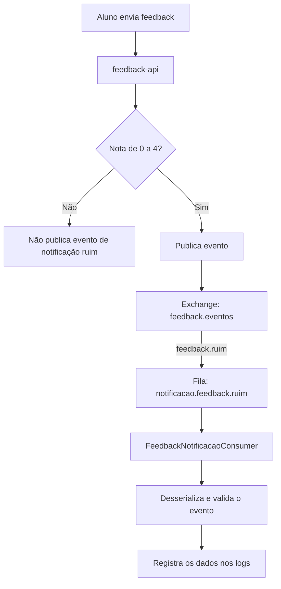

# Function Notification

Function responsável por consumir eventos de feedback classificados como ruins, publicados pela aplicação `feedback-api` no RabbitMQ. A aplicação foi desenvolvida com Quarkus e utiliza o SmallRye Reactive Messaging para receber as mensagens de forma assíncrona.

> **Estado atual:** a function consome, desserializa, valida e registra os dados do evento nos logs. O código ainda não realiza o envio de notificações por e-mail, SMS, push ou outro canal externo.

## Responsabilidade no projeto

A `function-notification` integra o fluxo de feedback por meio de mensageria. Quando um aluno registra um feedback cuja nota pertence à classificação `RUIM` (notas de 0 a 4), a `feedback-api` publica um evento no RabbitMQ. Esta function permanece conectada ao broker e consome as mensagens destinadas à fila de notificações de feedback ruim.

A comunicação é assíncrona: a API publica o evento e a function o processa independentemente da requisição HTTP que cadastrou o feedback. Dessa forma, o processamento da mensagem não precisa ocorrer dentro do ciclo de resposta da API.

A function não consulta diretamente o banco de dados da aplicação e não mantém persistência própria. Os dados necessários ao processamento são transportados no corpo do evento.

## Tecnologias

| Tecnologia | Utilização |
|---|---|
| Java 25 | Linguagem e versão de compilação do projeto |
| Quarkus 3.40.1 | Framework da aplicação |
| SmallRye Reactive Messaging - RabbitMQ | Integração e consumo de mensagens do RabbitMQ |
| Jackson | Desserialização do payload JSON em DTOs Java |
| Maven | Gerenciamento de dependências e build |
| Docker | Empacotamento e execução em contêiner |

## Estrutura do projeto

```text
function-notification/
├── pom.xml
├── Dockerfile
└── src/
    └── main/
        ├── java/
        │   └── br/com/fiap/notification/
        │       ├── Main.java
        │       └── mensageria/
        │           ├── FeedbackNotificacaoConsumer.java
        │           └── dto/
        │               ├── CursoEvento.java
        │               ├── FeedbackAvaliacaoEvento.java
        │               ├── FeedbackClassificacaoEvento.java
        │               ├── FeedbackNotificacaoEvento.java
        │               ├── MatriculaEvento.java
        │               ├── StatusMatriculaEvento.java
        │               └── UsuarioSimplificadoEvento.java
        └── resources/
            └── application.yml
```

### Organização dos pacotes

- `mensageria`: contém o consumidor responsável por receber e processar os eventos publicados no RabbitMQ.
- `mensageria.dto`: contém os records que representam o contrato da mensagem e seus objetos aninhados, evitando que a function dependa diretamente das classes internas da `feedback-api`.
- `application.yml`: concentra a configuração da porta HTTP e da conexão/canal de entrada do RabbitMQ.

## Fluxo de processamento

1. O aluno envia um feedback pela `feedback-api`.
2. A API classifica a nota. Para notas de 0 a 4, a classificação é `RUIM`.
3. A API publica o evento no exchange `feedback.eventos`, utilizando a routing key `feedback.ruim`.
4. O RabbitMQ encaminha a mensagem para a fila `notificacao.feedback.ruim`.
5. O consumidor `FeedbackNotificacaoConsumer`, inscrito no canal `feedback-notificacoes`, recebe o conteúdo da mensagem como `byte[]`.
6. O Jackson converte o JSON para `FeedbackNotificacaoEvento` e seus DTOs aninhados.
7. A function valida os dados essenciais do evento e da matrícula.
8. Se a mensagem for válida, a function registra nos logs o identificador do feedback, a nota, a classificação, o nome do aluno e o nome do curso.



O processamento descrito acima representa o comportamento implementado atualmente. A etapa de envio efetivo de uma notificação a um destinatário ou serviço externo ainda não faz parte do código desta versão.

## Contrato da mensagem

A mensagem recebida é representada pelo record `FeedbackNotificacaoEvento`:

```java
public record FeedbackNotificacaoEvento(
    int versao,
    UUID feedbackId,
    String descricao,
    FeedbackAvaliacaoEvento avaliacao,
    MatriculaEvento matricula
) {
}
```

Os objetos relacionados representam a avaliação, a matrícula, o aluno, o curso, o professor e o status da matrícula. De forma resumida, o payload JSON esperado possui a seguinte estrutura:

```json
{
  "versao": 1,
  "feedbackId": "UUID_DO_FEEDBACK",
  "descricao": "Descrição do feedback",
  "avaliacao": {
    "nota": 3
  },
  "matricula": {
    "id": "UUID_DA_MATRICULA",
    "aluno": {
      "id": "UUID_DO_ALUNO",
      "nome": "Nome do aluno"
    },
    "curso": {
      "id": "UUID_DO_CURSO",
      "nome": "Nome do curso",
      "descricao": "Descrição do curso",
      "professor": {
        "id": "UUID_DO_PROFESSOR",
        "nome": "Nome do professor"
      }
    },
    "status": "EM_ANDAMENTO"
  }
}
```

Os valores de UUID e os textos do exemplo são ilustrativos. O payload efetivo deve respeitar os nomes e tipos definidos nos DTOs compartilhados pelo contrato entre a API e a function.

### Classificação da avaliação

A classe `FeedbackAvaliacaoEvento` calcula a classificação com base na nota:

| Nota | Classificação |
|---:|---|
| 0 a 4 | `RUIM` |
| 5 a 7 | `MEDIO` |
| 8 a 10 | `BOM` |

A classificação é derivada por `getClassificacao()`; o DTO da avaliação transporta a nota (`nota`). Uma nota fora do intervalo permitido resulta em erro durante a validação ou o cálculo da classificação.

### Status da matrícula

O DTO `StatusMatriculaEvento` representa os status aceitos pelo contrato atual:

- `EM_ANDAMENTO`
- `CONCLUIDA`

## Configuração

As configurações estão no arquivo `src/main/resources/application.yml`.

### Porta HTTP

```yaml
quarkus:
  http:
    port: 8082
```

A aplicação Quarkus inicia seu servidor HTTP na porta `8082`. No código enviado, não há recursos REST implementados; o processamento de negócio desta function ocorre pelo canal de entrada do RabbitMQ.

### Variáveis de ambiente

A conexão com o broker é configurada pelas seguintes propriedades:

| Variável | Descrição | Valor padrão local |
|---|---|---|
| `RABBITMQ_HOST` | Hostname do RabbitMQ | `localhost` |
| `RABBITMQ_PORT` | Porta AMQP do RabbitMQ | `5672` |
| `RABBITMQ_USERNAME` | Usuário de conexão | `feedback` |
| `RABBITMQ_PASSWORD` | Senha de conexão | `feedback` |

Os valores padrão facilitam a execução local. Em ambientes compartilhados ou de produção, as credenciais devem ser fornecidas por configuração segura do ambiente de execução, e não mantidas como valores fixos no arquivo de configuração.

### Canal RabbitMQ

O canal de entrada `feedback-notificacoes` está associado à seguinte topologia:

| Propriedade | Valor |
|---|---|
| Connector | `smallrye-rabbitmq` |
| Exchange | `feedback.eventos` |
| Fila | `notificacao.feedback.ruim` |
| Routing key | `feedback.ruim` |

A configuração define `declare: false` tanto para o exchange quanto para a fila. Portanto, esta function espera que esses recursos já existam no RabbitMQ. No projeto, a declaração da topologia é responsabilidade da `feedback-api`, por meio da configuração Spring AMQP/RabbitAdmin.

## Execução local

### Pré-requisitos

- JDK 25.
- Maven compatível com o projeto.
- RabbitMQ em execução e acessível.
- Exchange e fila configurados conforme a seção [Canal RabbitMQ](#canal-rabbitmq).

Configure as variáveis de ambiente de acordo com seu ambiente. Exemplo para um RabbitMQ local:

```bash
export RABBITMQ_HOST=localhost
export RABBITMQ_PORT=5672
export RABBITMQ_USERNAME=feedback
export RABBITMQ_PASSWORD=feedback
```

Na raiz do módulo `function-notification`, inicie o modo de desenvolvimento:

```bash
mvn quarkus:dev
```

Para gerar o pacote JVM:

```bash
mvn package -DskipTests
```

E execute o artefato gerado:

```bash
java -jar target/quarkus-app/quarkus-run.jar
```

## Execução com Docker

O `Dockerfile` utiliza build em múltiplos estágios. A primeira etapa compila a aplicação com Maven e JDK 25; a segunda utiliza uma imagem JRE 25 para executar o pacote Quarkus no formato fast-jar.

Na raiz do módulo `function-notification`, execute:

```bash
docker build -t function-notification .
```

Para iniciar o contêiner conectado a um RabbitMQ acessível pela rede Docker, informe as variáveis de ambiente:

```bash
docker run --rm \
  --add-host=host.docker.internal:host-gateway \
  -e RABBITMQ_HOST=host.docker.internal \
  -e RABBITMQ_PORT=5672 \
  -e RABBITMQ_USERNAME=feedback \
  -e RABBITMQ_PASSWORD=feedback \
  -p 8082:8082 \
  function-notification
```

O argumento `--add-host` permite que o contêiner alcance o host em instalações do Docker Engine no Linux. Em ambientes que já disponibilizam `host.docker.internal`, o ajuste pode não ser necessário. Em uma rede Docker Compose, utilize o nome do serviço RabbitMQ definido no `docker-compose.yml` (no projeto, `rabbitmq`) e mantenha os contêineres na mesma rede.

Na execução integrada do projeto, a function deve iniciar na mesma rede Docker do RabbitMQ e receber as credenciais correspondentes por variáveis de ambiente. A fila e o exchange precisam estar declarados antes do consumo, conforme descrito anteriormente.

## Logs e tratamento de mensagens inválidas

O consumidor registra um log ao receber uma mensagem e, após desserialização e validação bem-sucedidas, registra os principais dados do feedback processado.

A validação atual verifica:

- existência do evento e do identificador `feedbackId`;
- versão do evento igual a `1`;
- descrição não nula e não vazia;
- avaliação presente, com nota entre `0` e `10`;
- matrícula com identificador, aluno, curso e status;
- aluno e curso com identificadores;
- professor associado ao curso e com identificador.

Falhas de desserialização são convertidas em `IllegalArgumentException`. Falhas nas validações também lançam `IllegalArgumentException`. O código enviado não implementa uma política própria de retentativas, fila de mensagens mortas (DLQ) ou persistência de mensagens rejeitadas; o comportamento de entrega/rejeição após uma falha depende da configuração do conector e do broker.

## Considerações para implantação

Antes de disponibilizar a function em um ambiente de produção, devem ser avaliados, entre outros, os seguintes pontos:

- integrar o processamento a um canal real de notificação, caso o requisito seja avisar administradores ou outros destinatários;
- definir a estratégia de retentativa e o destino de mensagens que não puderem ser processadas (por exemplo, uma DLQ);
- avaliar idempotência para evitar efeitos duplicados caso uma mensagem seja entregue mais de uma vez;
- externalizar e proteger as credenciais do RabbitMQ;
- definir métricas, alertas e rastreabilidade para acompanhar mensagens recebidas, processadas e com falha;
- revisar a topologia, permissões e conectividade do broker no ambiente de cloud.

Esses itens são recomendações para a evolução/implantação e não devem ser interpretados como funcionalidades já implementadas nesta versão.
